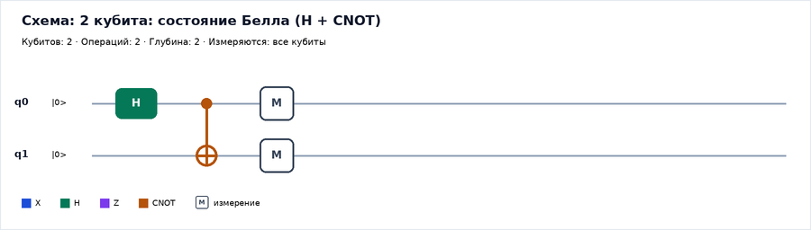
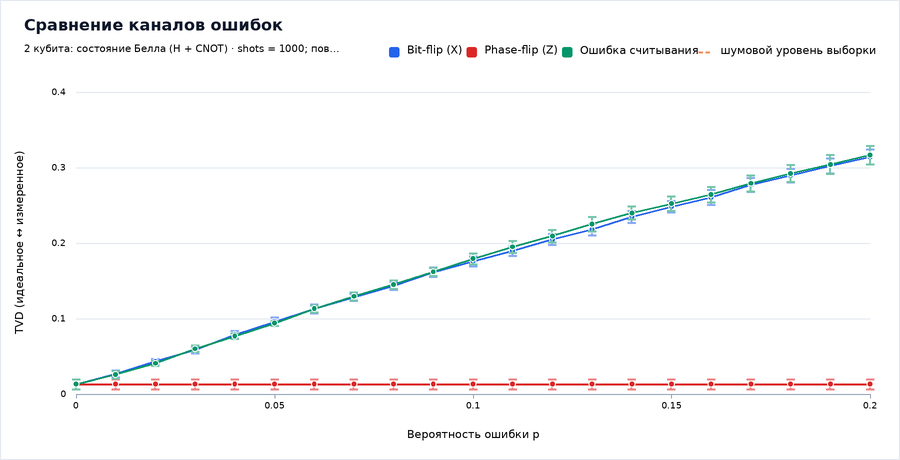

# Симулятор квантового компьютера

Учебно-исследовательский программный комплекс **«Моделирование архитектуры
квантового компьютера и исследование аппаратных ошибок»**.

Приложение собирает квантовые схемы из вентилей X, H, Z и CNOT, выполняет их
методом вектора состояния (statevector), моделирует аппаратные ошибки
(bit-flip, phase-flip, ошибка считывания), сравнивает идеальное и шумовое
распределения по метрике TVD и проводит серии воспроизводимых экспериментов
с экспортом в CSV и PNG.

Всё работает **локально**: без регистрации, API-ключей, облачных сервисов и
подключения к реальному квантовому процессору.



---

## Содержание

1. [Быстрый старт](#быстрый-старт)
2. [Что умеет приложение](#что-умеет-приложение)
3. [Разделы интерфейса](#разделы-интерфейса)
4. [Демонстрационные схемы](#демонстрационные-схемы)
5. [Эксперименты](#эксперименты)
6. [Математическая модель (кратко)](#математическая-модель-кратко)
7. [Ограничения модели](#ограничения-модели)
8. [Тесты и проверка](#тесты-и-проверка)
9. [Структура проекта](#структура-проекта)
10. [Соответствие техническому заданию](#соответствие-техническому-заданию)
11. [Устранение неполадок](#устранение-неполадок)
12. [Документация и источники](#документация-и-источники)

---

## Быстрый старт

### Вариант 1. Docker — ничего устанавливать не нужно

На компьютере должен быть только Docker (Windows 10/11 — Docker Desktop с
WSL 2, macOS — Docker Desktop, Linux — Docker Engine).

**Windows (PowerShell):**

```powershell
cd путь\к\quantum-computer-simulator
powershell -ExecutionPolicy Bypass -File docker\build-and-run.ps1
```

**Linux / macOS:**

```bash
cd путь/к/quantum-computer-simulator
bash docker/build-and-run.sh
```

**Или через docker compose:**

```bash
docker compose up -d --build
```

Через 20–40 секунд приложение откроется по адресу
**<http://localhost:8501>**. Python, pip и библиотеки на компьютере не нужны:
всё внутри образа.

> Первая сборка скачивает базовый образ и зависимости — нужен интернет.
> Дальше интернет не требуется. Как перенести готовый образ на ноутбук **без
> интернета**, описано в [docker/README.md](docker/README.md).

Остановить приложение:

```bash
docker rm -f quantum-simulator
```

### Вариант 2. Локальный запуск на Python 3.11+

**Windows, самый простой способ:** дважды щёлкните `run_app.bat` в папке
проекта. Скрипт сам найдёт (или создаст) окружение `.venv`, при необходимости
установит зависимости и откроет приложение в браузере.

**Или из PowerShell:**

```powershell
cd путь\к\quantum-computer-simulator
powershell -ExecutionPolicy Bypass -File scripts\run_local.ps1
```

**Или вручную:**

```bash
python -m venv .venv
# Windows: .venv\Scripts\activate
source .venv/bin/activate
pip install -r requirements.txt
streamlit run app.py
```

Браузер откроется автоматически; адрес — <http://localhost:8501>.

Если папка `.venv` уже создана и зависимости установлены, никакие команды
установки не нужны: `run_app.bat` и `scripts/run_local.ps1` сразу запускают
приложение и не обращаются в интернет.

**Проверенные версии окружения:** Python 3.13.7 (и 3.12.14), Streamlit 1.49.1,
NumPy 2.5.4, pandas 2.3.3, Pillow 11.3.0. В `requirements.txt` заданы
совместимые диапазоны: Streamlit 1.36–1.49, NumPy 1.26–2.x, pandas 2.2–2.x,
Pillow 10.1–12.x.

---

## Что умеет приложение

| Возможность | Реализация |
|---|---|
| Регистр 1–5 кубитов в интерактивном режиме | Вектор состояния на 2ⁿ комплексных амплитуд |
| Вентили X, H, Z, CNOT | Матрицы, применение к произвольным кубитам |
| Проверка схемы | Понятные сообщения об ошибках и предупреждения |
| Идеальное исполнение | Теоретические вероятности + случайное измерение |
| Ошибки вентилей | bit-flip (X), phase-flip (Z), отдельные вероятности |
| Ошибки считывания | readout, независимая инверсия каждого бита |
| Воспроизводимость | Поле seed; одинаковые параметры → одинаковый результат |
| Сравнение режимов | Гистограммы «идеально / с ошибками» рядом |
| Метрики | TVD, вероятность целевого результата, доля успешных запусков |
| Эксперименты | 6 видов серий, 1000 shots и 10 повторов по умолчанию |
| Статистика | Среднее, стандартное отклонение, 95 % доверительный интервал |
| Экспорт | CSV (сырые данные и средние), PNG (схемы и графики) |
| Демо-схемы | 9 готовых схем, включая состояние Белла и GHZ |
| Справка | Теория, вентили, измерение, модели ошибок, ограничения |

Приоритеты ТЗ: **P0 и P1 реализованы полностью**. Из P2 реализовано только
расширение числа кубитов в вычислительном ядре (до 10): сфера Блоха,
дополнительные каналы (амплитудное затухание, деполяризация) и сравнение
профилей устройств не реализованы — об этом сказано ниже, в разделе
«Ограничения модели».

---

## Разделы интерфейса

### Архитектура

Логическая схема комплекса показана изображением: пользовательская схема →
классический управляющий модуль → последовательность квантовых операций →
квантовый регистр → измерительный блок → классическая обработка →
результаты. Справа отдельной веткой показана модель аппаратных ошибок и
точки её влияния — исполнение вентилей и считывание. Блоки можно выбирать
в списке под схемой: ниже появляется пояснение о роли выбранного блока.
Отдельно оговорено, что это обобщённая функциональная модель, а не копия
конкретного устройства.

### Конструктор схем

- выбор числа кубитов (1–5) и измеряемых кубитов (все или часть);
- добавление вентиля с выбором целевого и управляющего кубитов;
- список операций: удаление, перемещение вверх/вниз;
- загрузка демонстрационной схемы, сохранение и загрузка JSON;
- схема перерисовывается при каждом изменении, рядом — число кубитов,
  операций и глубина;
- проверка корректности: например, у CNOT управляющий и целевой кубиты не
  могут совпадать.

### Запуск и результаты

- параметры: shots (100–20 000), seed, целевая битовая строка;
- вкладка «Распределения»: теоретические вероятности, гистограмма
  фактических измерений, таблица с числами;
- вкладка «Сравнение идеального и шумового»: два распределения на одном
  графике, TVD, статистический разброс выборки, вероятность целевой строки;
- вкладка «Состояние»: амплитуды (Re, Im), вероятности, проверка нормировки;
- вкладка «Данные и экспорт»: таблица и CSV.

### Аппаратные ошибки

- режим «Идеальная модель» / «Модель с ошибками»;
- независимые переключатели bit-flip, phase-flip и readout;
- вероятности от 0 до 0,2 (диапазон ТЗ);
- пояснение смысла и ограничений каждой модели;
- сравнение идеального и шумового исполнения на текущей схеме.

### Эксперименты

Шесть видов серий:

1. TVD от вероятности bit-flip;
2. TVD от вероятности phase-flip;
3. TVD от вероятности ошибки считывания;
4. TVD от числа операций (глубины схемы);
5. сравнение bit-flip, phase-flip и readout на одной схеме;
6. TVD от числа измерений (shots) — отделяет статистический разброс от
   вклада аппаратных ошибок.

Для каждой точки выполняется несколько повторов, считаются среднее,
стандартное отклонение и 95 % доверительный интервал. Результаты можно
скачать как CSV (все запуски или средние) и как PNG. Индикатор выполнения
показывает прогресс.

### Справка

Основы квантовых вычислений, таблица вентилей с матрицами, измерение и
запутанность, модели ошибок, ограничения симулятора и краткая инструкция.

---

## Демонстрационные схемы

Файл [`examples/demo_circuits.json`](examples/demo_circuits.json) — 9 схем:

| Ключ | Схема | Что показывает |
|---|---|---|
| `one_qubit_h` | 1 кубит: H | Частоты 0 и 1 близки к 50/50 |
| `bit_flip` | 1 кубит: X | Всегда 1; при ошибке считывания появляются нули |
| `bell` | 2 кубита: H + CNOT | Только 00 и 11 — запутанность |
| `ghz3` | 3 кубита: H + 2 CNOT | Запутанность трёх кубитов |
| `phase_demo` | 1 кубит: H–Z–H | Фазовая ошибка становится видимой |
| `superposition_3` | 3 кубита: H на каждом | Равномерное распределение |
| `readout_only` | 1 кубит без вентилей | Чистый эффект ошибки считывания |
| `bell_depth` | Белл + пары CNOT | Накопление ошибок с глубиной |
| `entangled_4` | GHZ-4 с частичным измерением | Корреляции при измерении части кубитов |

---

## Эксперименты



Метрика — полное вариационное расстояние:

```
TVD(P, Q) = 0.5 × Σ |P(x) − Q(x)|
```

Оно сравнивает теоретические вероятности идеального исполнения с частотами,
полученными при включённых ошибках. Дополнительно показывается **шумовой
уровень** — TVD идеальной выборки при тех же shots; значения ниже него
неотличимы от случайного разброса.

Методика, переменные и ограничения подробно описаны в
[docs/EXPERIMENTS.md](docs/EXPERIMENTS.md). При повторном запуске с тем же
seed результаты воспроизводятся.

Готовые примеры (получены реальным запуском, а не нарисованы вручную):

- [experiment_bitflip.csv](examples/results/experiment_bitflip.csv) и
  [график](examples/results/experiment_bitflip.png);
- [experiment_readout.csv](examples/results/experiment_readout.csv);
- [experiment_depth.csv](examples/results/experiment_depth.csv) и
  [график](examples/results/experiment_depth.png);
- [experiment_compare.csv](examples/results/experiment_compare.csv) и
  [график](examples/results/experiment_compare.png);
- experiment_shots.csv — серия по числу измерений (генерируется скриптом
  scripts/generate_examples.py);
- [distributions и сравнение режимов](examples/results/comparison_bell_noise.png).

Перегенерировать примеры: `python scripts/generate_examples.py`.

---

## Математическая модель (кратко)

Состояние регистра из n кубитов — вектор комплексных амплитуд длины 2ⁿ:

```
|ψ⟩ = Σ_x α_x |x⟩,   Σ_x |α_x|² = 1
```

Битовая строка читается слева направо, **крайний левый символ — кубит 0**;
на схеме кубит 0 — верхняя линия. Вентили применяются как матрицы:

```
H = 1/√2 · [[1, 1], [1, −1]]     X = [[0, 1], [1, 0]]
Z = [[1, 0], [0, −1]]            CNOT = [[1,0,0,0], [0,1,0,0], [0,0,0,1], [0,0,1,0]]
```

Измерение: вероятность строки x равна |α_x|²; для каждого из shots
разыгрывается исход по кумулятивному распределению.

Ошибки: после вентиля к каждому затронутому кубиту с вероятностью p
применяется X (bit-flip) или Z (phase-flip); при измерении каждый бит
независимо инвертируется с вероятностью p_readout. Для CNOT ошибки
разыгрываются независимо для управляющего и целевого кубитов.

Подробный вывод, обоснование траекторного моделирования и оценка памяти —
в [docs/MATH_MODEL.md](docs/MATH_MODEL.md).

---

## Ограничения модели

- **Размер регистра.** Вектор состояния растёт как 2ⁿ (16 байт на амплитуду).
  Интерактивный режим — до 5 кубитов, вычислительное ядро — до 10. Для
  больших регистров память ограничивается явно.
- **Модели ошибок упрощены.** Нет амплитудного затухания, деполяризующего
  канала, T1/T2, кросс-помех, дрейфа калибровки и коррелированных ошибок.
  Симметричная ошибка считывания — тоже упрощение.
- **Вентили идеальны и мгновенны.** «Глубина» — число слоёв операций, а не
  физическое время.
- **Измерение только в Z-базисе.** Томография и измерение в других базисах
  не реализованы.
- **Сфера Блоха не реализована.** Для запутанных и смешанных состояний её
  нельзя показывать для каждого кубита как независимое описание; в P2 она
  отмечена как необязательная.
- **Нет подключения к реальному устройству.** Симуляция не выдаётся за
  запуск на квантовом процессоре.

---

## Тесты и проверка

```bash
# Все автоматические тесты (143 теста)
python -m unittest discover -s tests -t .

# То же через pytest, если он установлен
python -m pytest -q

# Проверка страниц без Streamlit (заглушка API)
python tools/ui_check.py

# Проверка в настоящем рантайме Streamlit: все разделы и основные действия
python tools/app_test.py
```

Тесты проверяют:

- X|0⟩ = |1⟩, XX = I, H|0⟩ → 0,5/0,5, HH = I, Z меняет фазу, но не вероятности;
- CNOT с управляющим и целевым кубитами в любом порядке, запрет совпадения;
- совпадение быстрой реализации с независимой эталонной (перебор индексов);
- состояние Белла: только 00 и 11;
- нормировку состояния;
- при p = 0 шумовой запуск совпадает с идеальным;
- readout p = 0,5 для |0⟩ даёт равномерное распределение;
- статистическое совпадение быстрых шумовых траекторий с эталонной моделью;
- валидацию параметров, пустых схем и индексов кубитов;
- воспроизводимость по seed, экспорт CSV, работу серий экспериментов;
- загрузку и корректность всех демонстрационных схем.

Внутри Docker-контейнера тесты тоже доступны:

```bash
docker run --rm quantum-computer-simulator:1.0.0 python -m unittest discover -s tests -t .
```

---

## Структура проекта

```
quantum-computer-simulator/
├── app.py                     точка входа и навигация
├── run_app.bat                запуск без Docker в один клик (Windows)
├── requirements.txt           зависимости
├── Dockerfile                 образ приложения
├── docker-compose.yml         запуск одной командой
├── README.md                  этот файл
├── .streamlit/config.toml     тема и настройки сервера (без телеметрии)
├── assets/                    шрифты DejaVu и схема архитектуры (PNG)
├── docs/
│   ├── ARCHITECTURE.md        архитектура и интерфейсы модулей
│   ├── MATH_MODEL.md          математическая модель и модели ошибок
│   ├── EXPERIMENTS.md         методика экспериментов
│   ├── DEMO_SCRIPT.md         сценарий демонстрации на 3–5 минут
│   └── SOURCES.md             источники
├── docker/
│   ├── README.md              запуск и перенос образа
│   ├── build-and-run.ps1/.sh  сборка и запуск
│   ├── export-image.ps1/.sh   docker save для переноса
│   └── load-and-run.ps1/.sh   docker load и запуск
├── src/
│   ├── quantum/
│   │   ├── statevector.py     вектор состояния и операции
│   │   ├── gates.py           X, H, Z, CNOT и описания
│   │   ├── circuit.py         схема, проверка, сериализация
│   │   ├── noise.py           модели аппаратных ошибок
│   │   ├── measurement.py     вероятности, sampling, readout
│   │   └── simulator.py       исполнение и шумовые траектории
│   ├── experiments/
│   │   ├── runner.py          серии запусков
│   │   ├── metrics.py         TVD и другие метрики
│   │   └── export.py          CSV
│   ├── render/                графики PNG и текстовая схема архитектуры
│   ├── ui/                    страницы Streamlit
│   └── demo.py                загрузка демонстрационных схем
├── examples/
│   ├── demo_circuits.json     9 готовых схем
│   └── results/               реальные CSV и PNG, полученные программой
├── tests/                     модульные тесты (unittest/pytest)
├── scripts/                   запуск, проверки, генерация примеров
└── tools/
    ├── ui_check.py            проверка страниц без Streamlit
    └── app_test.py            проверка в настоящем рантайме Streamlit
```

---

## Соответствие техническому заданию

| Критерий приёмки | Где реализовано |
|---|---|
| Запуск по инструкции README | Docker и локальный запуск, раздел «Быстрый старт» |
| Выбор 1–5 кубитов, схема из X/H/Z/CNOT | «Конструктор схем» |
| Корректные вероятности и случайное измерение с shots | `src/quantum/measurement.py`, тесты |
| Три модели ошибок | `src/quantum/noise.py`, тесты |
| Переключение идеального и шумового режима | «Аппаратные ошибки», «Запуск и результаты» |
| Архитектурная схема с пояснениями | «Архитектура», `assets/architecture.png` |
| Не менее трёх демо-сценариев, включая Белла | `examples/demo_circuits.json` (9 схем) |
| Экспериментальные зависимости | «Эксперименты», 6 видов серий |
| CSV и PNG | `src/experiments/export.py`, `src/render/` |
| Автоматические тесты и ограничения | `tests/` (143 теста), README и docs |
| Инструкция демонстрации и реальные примеры | `docs/DEMO_SCRIPT.md`, `examples/results/` |

---

## Устранение неполадок

| Проблема | Решение |
|---|---|
| Порт 8501 занят | Запустите на другом порту: `docker run -p 8600:8501 ...`, либо остановите прежний контейнер |
| Docker пишет `Cannot connect to the Docker daemon` | Запустите Docker Desktop / службу Docker |
| Сборка образа падает на установке зависимостей | Нет доступа к PyPI — используйте готовый образ (`docker/load-and-run.ps1`) |
| `ModuleNotFoundError: streamlit` | Установите зависимости: `pip install -r requirements.txt` |
| Кириллица на графиках не отображается | Проверьте, что каталог `assets/fonts` скопирован вместе с проектом |
| Приложение открылось, но страница пустая | Обновите страницу (F5); проверьте журнал `docker logs quantum-simulator` |
| Эксперимент идёт долго | Уменьшите shots, число повторов или точек |

---

## Документация и источники

- [docs/ARCHITECTURE.md](docs/ARCHITECTURE.md) — модули, поток данных,
  интерфейсы и принятые решения.
- [docs/MATH_MODEL.md](docs/MATH_MODEL.md) — вектор состояния, вентили,
  измерение, ошибки, TVD.
- [docs/EXPERIMENTS.md](docs/EXPERIMENTS.md) — исследовательская методика.
- [docs/DEMO_SCRIPT.md](docs/DEMO_SCRIPT.md) — выступление на 3–5 минут.
- [docs/SOURCES.md](docs/SOURCES.md) — книги, документация и статьи.
- [docker/README.md](docker/README.md) — запуск и перенос образа.

Проект распространяется по лицензии MIT (см. [LICENSE](LICENSE)). Шрифты
DejaVu поставляются по собственной лицензии — см.
[assets/fonts/README.md](assets/fonts/README.md).
